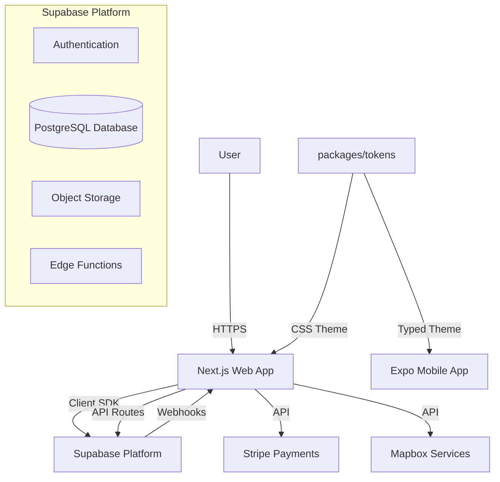

# Architecture Overview for BlockHyre Web App

This document serves as a critical, living template designed to equip agents with a rapid and comprehensive understanding of the `apps/web` codebase's architecture, enabling efficient navigation and effective contribution from day one. Update this document as the codebase evolves.

## 1. Project Structure

This section provides a high-level overview of the `apps/web` directory structure. The project is part of a monorepo (`BlockHyre_Monorepo`) managed by Turborepo and pnpm workspaces:
- `apps/web`: Next.js 16 (App Router), React 19, Tailwind CSS 4, Radix UI.
- `apps/mobile`: Expo 54, React Native, Expo Router.
- `packages/tokens`: Universal Design System tokens (@repo/tokens) exporting typed TypeScript constants and compiled Tailwind CSS variables.
- `packages/database`: Shared database types and Supabase helpers.

```
BlockHyre_Monorepo/
├── packages/
│   ├── database/             # Shared database schemas and helpers
│   └── tokens/               # Shared Design System package (@repo/tokens)
│       ├── package.json
│       ├── tsconfig.json
│       └── src/
│           ├── colors.ts     # Primitive & semantic colors (Electric Indigo, Safety Orange, etc.)
│           ├── radii.ts      # Strict 5-tier semantic radii scale
│           ├── typography.ts # Font families, sizing, line-heights, tracking
│           ├── tokens.css    # CSS variables for Tailwind v4 theme integration
│           └── index.ts      # Typed cross-platform exports for Web & Mobile
├── apps/web/
│   ├── app/                  # Next.js App Router (16.0.7) - Main application logic
│   │   ├── (auth)/           # Authentication flows (login, signup)
│   │   ├── api/              # API Routes (backend-for-frontend)
│   │   ├── components/       # App-specific components (dashboard, modals, search)
│   │   ├── context/          # React Context providers (Auth, Dashboard, Message, etc.)
│   │   ├── dashboard/        # Protected dashboard routes & sub-views
│   │   ├── hooks/            # Custom React hooks
│   │   ├── lib/              # Utility functions and shared logic
│   │   ├── listings/         # Listing feature routes
│   │   ├── types/            # TypeScript type definitions
│   │   ├── globals.css       # Imports @repo/tokens and defines Tailwind v4 @theme
│   │   ├── layout.tsx        # Root layout
│   │   └── page.tsx          # Homepage
│   ├── components/           # Reusable UI components
│   │   ├── ui/               # Radix UI + shadcn/ui primitives wired to tokens
│   │   └── shared/           # Business-logic specific components
│   ├── hooks/                # Custom React hooks (e.g., `use-toast`)
│   ├── lib/                  # Core utilities and client configurations
│   │   ├── supabase.ts       # Supabase client instantiation
│   │   ├── stripe.ts         # Stripe client helper
│   │   ├── location.ts       # Mapbox/Location utilities
│   │   └── utils.ts          # General helper functions (cn, clsx)
│   ├── public/               # Static assets (images, fonts, icons)
│   ├── supabase/             # Supabase specific configurations/migrations for the web app
│   ├── middleware.ts         # Next.js Middleware for session handling and route protection
│   ├── next.config.ts        # Next.js configuration
│   └── package.json          # Dependencies and scripts
└── apps/mobile/              # Expo React Native application
```

## 2. High-Level System Diagram

A simplified view of the system components and data flow:



## 3. Core Components

### 3.1. Frontend Application
**Name:** BlockHyre Web  
**Description:** The main user interface for the BlockHyre platform. It handles user authentication, listing discovery, booking management, and dashboard functionalities. Built with a component-driven architecture using React Server Components where applicable.  
**Technologies:**
- **Framework:** Next.js 16 (App Router)
- **Library:** React 19
- **Styling:** Tailwind CSS 4 with `@theme` token bindings
- **Design System:** `@repo/tokens` universal design tokens package
- **UI Components:** Radix UI (Headless), Lucide React (Icons), Vaul (Drawer), Sonner (Toasts)
- **State Management:** URL state (`nuqs`), React Context, Local State, Supabase Realtime
- **Maps:** Mapbox GL
- **Payments:** Stripe

### 3.2. Design System Architecture (`packages/tokens`)
**Name:** BlockHyre Tokens (`@repo/tokens`)  
**Description:** Single source of truth for the "Industrial Boutique" design system shared across Web and Mobile.
- **Color Architecture:**
  - **Electric Indigo (`#5B6EAE`):** Primary brand CTA, active tabs, focus rings, brand accent links.
  - **Midnight Navy (`#1B2A4A`):** High-contrast dark cards, hero headers, primary pricing, CTA hover states.
  - **Periwinkle Blue (`#7289DA`):** Dark mode primary accent & interactive contrast.
  - **Safety Orange (`#FF6B00`):** Dedicated semantic urgency, High-Power Tier 3 Safety Gate modal, legal & liability cautions, return countdown timers (strictly separated from general CTAs).
  - **Peace Fund Emerald (`#10B981`):** Operational status dots, insured coverage indicators, net earnings.
  - **Charcoal (`#1A1A1A`) & Deep Charcoal (`#1C1C2E`):** Industrial dark surfaces, sidebar navigation, telemetry containers.
  - **Concrete (`#E8E4DD`) & Signal White (`#FAFAF8`):** Workshop tactile backgrounds and crisp canvas.
- **Strict 5-Tier Semantic Corner Radii Scale:**
  - `none (0px)`: Hard machinery edges.
  - `subtle (6px)`: Inputs, badges, small tags, telemetry brackets.
  - `default / interactive (10px)`: Buttons, interactive controls, dropdowns, icon containers.
  - `card (16px)`: Standard content cards, dashboard containers, dialogs.
  - `boutique (40px / 2.5rem)`: Signature boutique curves for hero and primary tool cards.
  - `full (9999px)`: Circular status dots, user avatars, pill badges.
- **Export Targets:**
  - Compiled CSS variables via `@repo/tokens/tokens.css` ingested by Tailwind v4 `@theme`.
  - Typed JavaScript/TypeScript constants for React Native `StyleSheet` usage in `apps/mobile`.

### 3.3. Backend Services
The backend logic is primarily serverless, leveraging Next.js API routes and Supabase's managed backend features.

#### 3.3.1. Next.js API Routes (`app/api`)
**Description:** Handles server-side logic that requires secure environments or third-party webhooks.
**Key Endpoints:**
- `/api/stripe/checkout`: Initiates Stripe Checkout sessions.
- `/api/stripe/webhook`: Handles Stripe webhooks securely.
- `/api/signup`: Enforces custom validation and rate limiting for account creation.

#### 3.3.2. Supabase Backend
**Description:** Acts as the primary backend-as-a-service, handling authentication, database interactions, and file storage.
**Key Features:**
- **Auth:** Manages user sessions and Row Level Security (RLS).
- **Database:** PostgreSQL for all application data.
- **Storage:** Buckets for user uploads (avatars, listing images).
- **Edge Functions:** Deno-based serverless functions for complex logic.

## 4. Messaging System

The platform features a real-time messaging system for communication between owners and renters.

### 4.1. Consolidated Chat Model
- **Relationship:** 1:1 relationship between any two users (Owner + Renter).
- **Consolidation:** All inquiries or bookings between the same two users are routed to a single, persistent chat thread regardless of the listing.
- **Contextual Awareness:** The `LISTING_INQUIRY` system message is used as a "topic header" in the unified thread whenever a user initiates contact for a specific tool.

### 4.2. Implementation
- **Real-time:** Powered by Supabase Broadcast channels for message delivery and Postgres Changes for notification syncing.
- **RPC Logic:** `upsert_conversation` handles the atomic lookup/creation of user-pair chats.
- **Templating:** Uses `system_message_templates` table with Liquid logic to render role-specific system notifications (confirmations, rejections, etc.).

## 5. Data Stores

### 5.1. Primary Database (PostgreSQL)
**Name:** BlockHyre Database (Supabase)  
**Type:** PostgreSQL  
**Purpose:** Stores all persistent application data including users, listings, bookings, and transactions.  
**Key Tables:** `users`, `listings`, `rentals`, `conversations`, `messages`, `favorites`.

### 5.2. Object Storage
**Name:** Supabase Storage  
**Type:** Object Store (S3-compatible)  
**Purpose:** Stores user-uploaded content.  
**Key Buckets:** `avatars`, `listing-images`.

## 6. External Integrations / APIs

### 6.1. Stripe
**Purpose:** Payment processing for rentals and deposits.  
**Integration Method:** Stripe Node.js SDK (API Routes) & Stripe.js (Client).

### 6.2. Mapbox
**Purpose:** Location services, geocoding, and map rendering for listings.  
**Integration Method:** Mapbox GL JS, Mapbox Geocoding API.

### 6.3. Supabase Auth
**Purpose:** User authentication and identity management.  
**Integration Method:** `@supabase/ssr` (Next.js middleware & server/client components).

## 7. Security Considerations

**Authentication:** 
- Powered by Supabase Auth (JWT-based).
- Protected routes via Next.js middleware using `@supabase/ssr`.

**Authorization:**
- **Row Level Security (RLS):** Policies defined directly on Postgres tables to restrict data access at the database level.
- **Middleware:** `middleware.ts` ensures protected routes redirect unauthenticated users.

**Data Protection:**
- Environment variables (`.env.local`) manage sensitive API keys (Stripe Secret Key, Supabase Service Role).
- HTTP Security Headers (CSP, HSTS, X-Frame-Options) as standard practice.

## 8. Deployment & Infrastructure

**Cloud Provider:** VPS (Web App), Supabase (Backend/DB)  
**Monorepo Tooling:** Turborepo for build orchestration and caching.  
**CI/CD Pipeline:** GitHub Actions.  

## 9. Development Environment

**Local Setup:**
1. Clone the repository.
2. Install dependencies: `pnpm install` (monorepo standard).
3. Set up environment variables in `.env.local` (Supabase URL/Key, Stripe Keys).
4. Run development server: `pnpm dev`.

**Local Backend:**
- Supabase local development via `supabase start` (requires Docker).

**Code Quality:**
- **Linting:** ESLint (`pnpm lint`).
- **Formatting:** Prettier (implied).

## 10. Future Considerations / Roadmap

- **Testing Strategy:** Comprehensive unit (Jest/Vitest) and E2E (Playwright) testing suites.
- **Cross-Platform Mobile:** Mobile app parity backed by `@repo/tokens`.
- **Real-time Notifications:** Expand messaging model to include push notifications and multi-device sync.
- **Accessibility:** Full WCAG AA contrast compliance with electric indigo and midnight navy palettes.

## 11. Project Identification

**Project Name:** BlockHyre Web  
**Repository Path:** `apps/web`  
**Primary Tech:** Next.js, Supabase, Tailwind CSS, Turborepo  
**Date of Last Update:** 2026-11-05

## 12. Glossary / Acronyms

**RLS:** Row Level Security (PostgreSQL security feature).  
**SSR:** Server-Side Rendering.  
**ISR:** Incremental Static Regeneration.  
**RPC:** Remote Procedure Call (Supabase functions).
